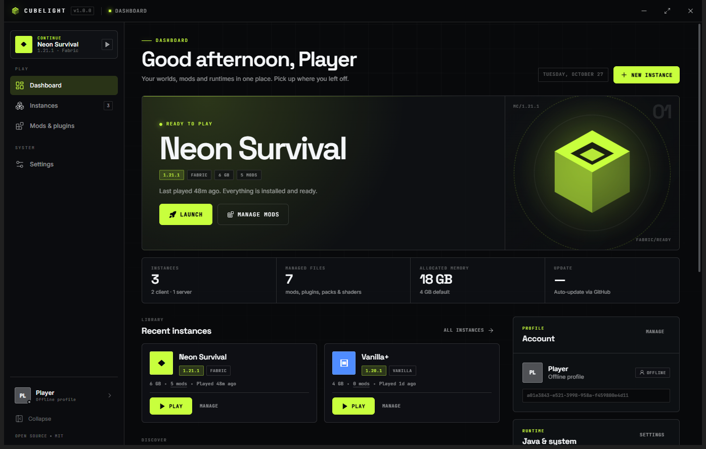

# Cubelight

An open-source Minecraft launcher for Windows, macOS and Linux. Cubelight creates isolated instances, installs Minecraft with a matching Java runtime, and pulls mods, plugins, resource packs and shaders from Modrinth and CurseForge.

[](https://github.com/PopimGamesStudios/cubelight/actions/workflows/ci.yml)
[](https://github.com/PopimGamesStudios/cubelight/releases/latest)
[](LICENSE)



> Cubelight is an independent project. It is not affiliated with Mojang or Microsoft.

## Features

- **Instances**: client instances (Vanilla, Fabric, Forge, NeoForge) and server instances (folder-only, with `mods/` and `plugins/`), each with its own game directory.
- **Automatic runtime setup**: Minecraft versions, libraries, assets and a matching Temurin Java runtime are downloaded and verified on first launch.
- **Modrinth + CurseForge**: search, filter and install mods, plugins, resource packs and shaders straight into the right instance folder. Dependency-aware installs and update checks.
- **Accounts**: offline profiles work instantly; Microsoft accounts use the device-code flow and refresh tokens are encrypted with the OS keychain.
- **Tray and startup**: close to tray, start minimized, launch at login, minimize the launcher when a game starts.
- **Deep appearance settings**: theme presets, custom accent/background/surface/text colors, UI and display fonts, base font size, UI scale, corner radius, density, background pattern and a collapsible sidebar.
- **Auto-updates**: packaged builds update themselves from GitHub Releases through `electron-updater`.
- **Logs**: per-instance launch logs with copy-to-clipboard and file reveal.

## Download

**[Download the latest version →](https://github.com/PopimGamesStudios/cubelight/releases/latest)**

The download page lists every release and its files:

| Platform | Artifact | Notes |
| --- | --- | --- |
| Windows | `Cubelight-Setup-<version>.exe` | Installer with desktop and Start Menu shortcuts |
| Windows | `Cubelight-<version>-portable.exe` | Single file, no installation |
| macOS | `Cubelight-<version>-<arch>.dmg` | Unsigned by default |
| Linux | `Cubelight-<version>-linux-x86_64.AppImage` | Not yet code signed |

Direct link to the current Windows installer:

```
https://github.com/PopimGamesStudios/cubelight/releases/latest/download/Cubelight-Setup-1.0.2.exe
```

Step-by-step Windows instructions, including the SmartScreen prompt and uninstall, are in [INSTALL.md](INSTALL.md).

The Windows builds are unsigned, so SmartScreen may warn on first run. Choose **More info → Run anyway**, or build it yourself.

## Development

Requirements: Node.js 22+ and npm.

```bash
npm install
npm run dev        # Vite + Electron with hot reload
npm run dev:web    # UI only, in a browser, against mock data
npm run typecheck  # both TypeScript projects
npm run build      # production renderer + Electron main
npm run pack       # unpacked app in release/
npm run dist:win   # Windows installer in release/
```

`npm run dev:web` renders the interface with `src/lib/mock.ts` when `window.cubelight` is missing. It is a UI playground only; the real filesystem, Modrinth, CurseForge, Java and update code lives in `electron/`.

### Project layout

```
electron/            main process
  lib/               settings, instances, minecraft, java, auth, mods,
                     modrinth, curseforge, updater, tray, download
  main.ts            window, single-instance lock, lifecycle
  preload.ts         contextBridge API (window.cubelight)
shared/              types and defaults shared by both processes
src/                 React renderer (pages, components, store, styles)
build/               icons and tray asset
scripts/             icon generation
```

## Configuration

Everything below is optional except the GitHub repository values if you want auto-updates.

### CurseForge API key

CurseForge requires a personal API key:

1. Create one at <https://console.curseforge.com/>.
2. Open **Settings → Integrations** in Cubelight and paste it.

The key is stored in the launcher's settings JSON in your user data folder. Modrinth needs no key.

### Microsoft sign-in

Microsoft accounts need an Azure public client ID that you own:

1. In the [Azure portal](https://portal.azure.com/#view/Microsoft_AAD_RegisteredApps/ApplicationsListBlade), register an app.
2. Add the **Mobile and desktop applications** platform and enable the public client flow.
3. Copy the application (client) ID into **Settings → Integrations → Minecraft account**.

Offline profiles work without any of this.

### GitHub repository (auto-updates)

Cubelight publishes to `PopimGamesStudios/cubelight`. The same values appear in three places:

| File | Key |
| --- | --- |
| `electron-builder.yml` | `publish.owner`, `publish.repo` |
| `src/lib/links.ts` | `GITHUB_REPO` |
| `shared/defaults.ts` | `launcher.modrinthUserAgent` (optional, courtesy string) |

To publish under a different account or repository name, change all three and rebuild. If the repository does not exist yet, Cubelight shows "Auto-update is not configured" and skips update checks instead of failing.

## Releasing

Auto-update works by publishing a GitHub Release whose artifacts include `latest.yml` (Windows), `latest-mac.yml` (macOS) and `latest-linux.yml` (Linux).

```bash
npm version patch        # bumps package.json and creates a v1.0.2 tag
git push --follow-tags   # triggers .github/workflows/release.yml
```

The workflow builds on Windows, macOS and Linux and uploads the installers plus update manifests to the release. Installed copies poll that release every four hours and on startup.

Manual release:

```bash
GH_TOKEN=<token> npm run release
```

Notes:

- Update checks only run in packaged builds. Development builds report `dev`.
- macOS builds are unsigned by default (`identity: null`). For distribution, add a Developer ID certificate and notarization.
- Windows builds are unsigned unless you provide a code-signing certificate through `CSC_LINK` / `CSC_KEY_PASSWORD`.

## Data locations

| Platform | Path |
| --- | --- |
| Windows | `%APPDATA%\Cubelight` |
| macOS | `~/Library/Application Support/Cubelight` |
| Linux | `~/.config/Cubelight` |

Settings, accounts and instance metadata live there; game files live under `instances/` in the same folder.

## Security

- The renderer has no Node.js access. All privileged work goes through the typed `contextBridge` API in `electron/preload.ts`.
- Microsoft refresh tokens are encrypted with Electron `safeStorage` when the OS keychain is available.
- `contextIsolation` and `sandbox` are enabled and remote content is never loaded inside the app window.
- CurseForge API keys are stored as plain text in the settings file, because the app needs the raw key to sign requests. Treat that file as a secret.

## Legal

- [Terms & Conditions](docs/terms.md)
- [Privacy Policy](docs/privacy.md)

The same documents are available in the application under **Settings, Terms** and **Settings, Privacy**.

## License

[MIT](LICENSE)
